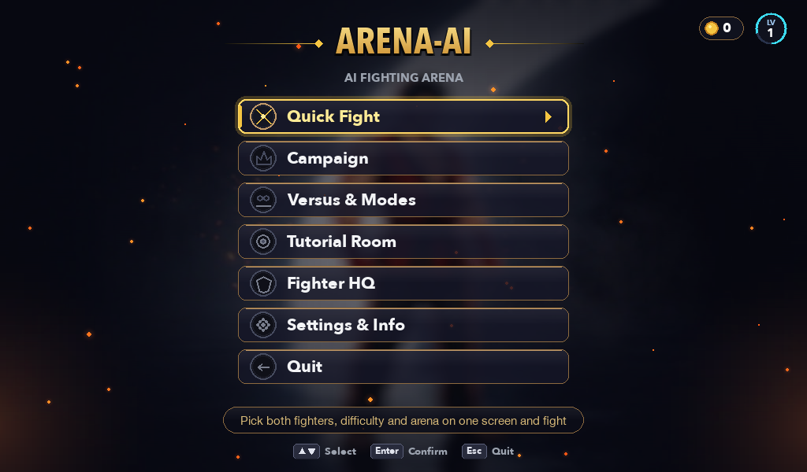
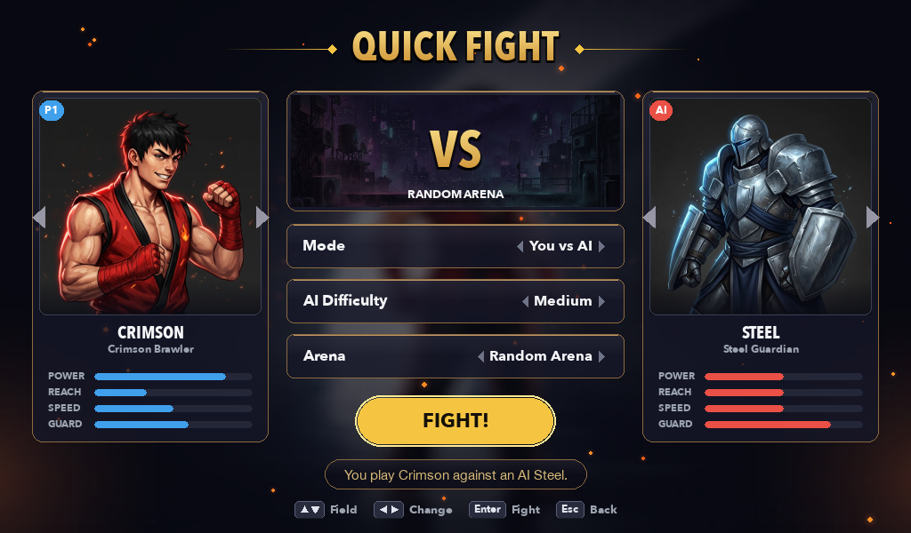
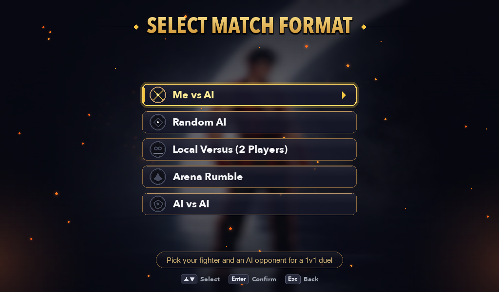
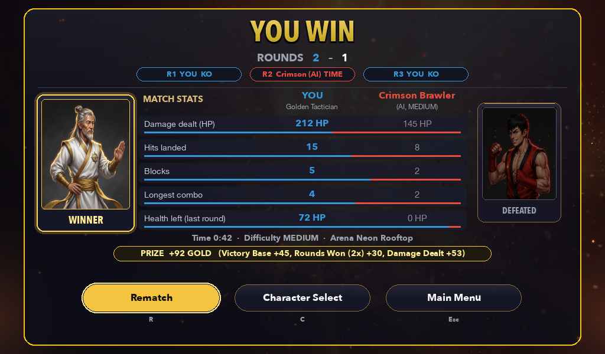
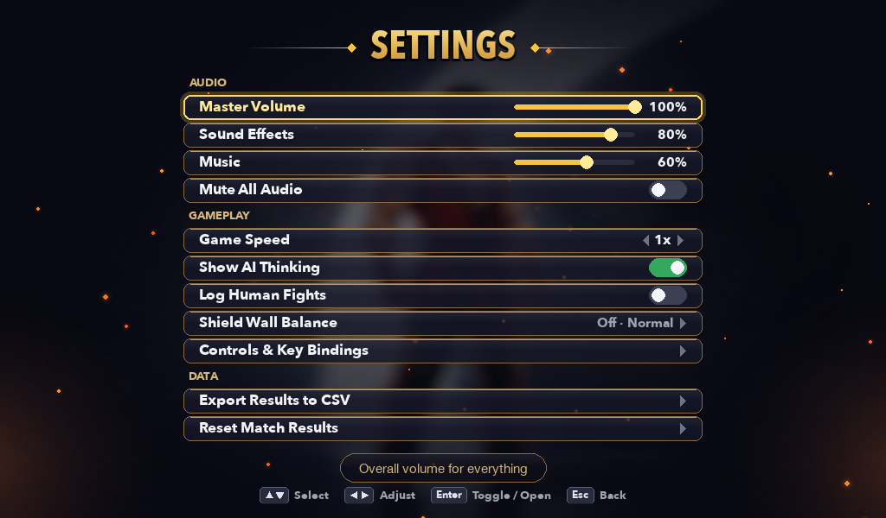
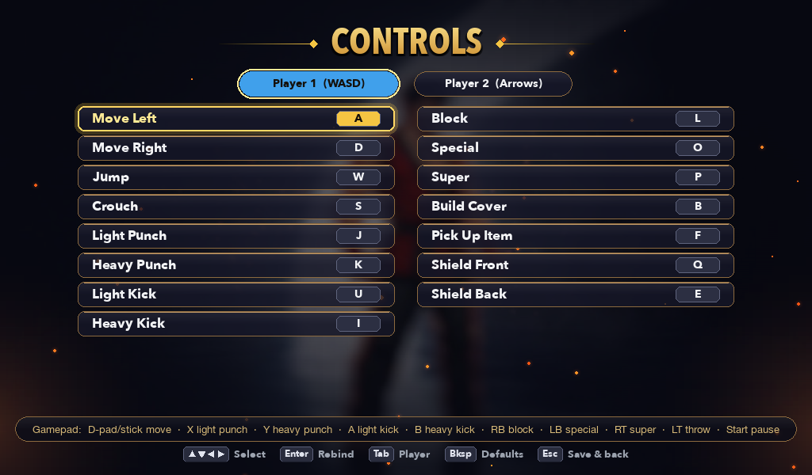

# Frontend: menus, flow, input, audio

## How to run
```
uv run python -m frontend
```

## Screens and flow



```
Intro ─▶ Main Menu ─┬─ Quick Fight ─────────────▶ fight ─▶ Results ─┬─ Rematch (default, Enter)
                    ├─ Campaign ─▶ map ─▶ story ─▶ fight ─▶ Results ├─ Character Select / Campaign Map
                    ├─ Versus & Modes ─▶ match type ─▶ fighters ─▶ difficulty ─▶ fight ─▶ Results
                    ├─ Tutorial Room          (Esc on the main menu asks "Quit Arena-AI?")
                    ├─ Fighter HQ ─▶ Upgrades / Missions / Trophies / Statistics
                    ├─ Settings & Info ─▶ Settings / Controls / Manual / AI Insights
                    └─ Quit
```

* **Quick Fight** (`screens.quick_fight_screen`) – one screen with P1 fighter, P2 fighter,
  mode (You vs AI / Local Versus / AI vs AI), AI difficulty and arena side by side.
  ↑/↓ moves between fields, ←/→ changes them, Enter starts. Results → "Character Select"
  reopens Quick Fight with the previous choices.
  
* **Versus & Modes** – Me vs AI, Random AI, **Local Versus (2 players)**, Arena Rumble
  (rules screen, then straight to fighter select – no nested menus), AI vs AI.
  
* **Results** – Rematch is the default button (Enter = instant rematch after a 0.8 s
  anti-mash lockout); `R` / `C` / `Esc` are shortcuts. Coins are granted for human-vs-AI
  matches only. 
* **Campaign** – results buttons are *Retry Battle / Campaign Map / Main Menu*.
* **Upgrades** open on the fighter you last played (←/→ switches fighter).
* **Settings** are persisted to `data/settings.json`; key bindings to `data/controls.json`.
   

`frontend/main.py` keeps the flow flat: `_match_session()` runs the rematch loop and
`_start_match()` plays exactly one match, returning `MatchOutcome(action, setup)` (a
NamedTuple, so `action, setup = _start_match(...)` works). `MatchSetup` is a dataclass
(`match_type, p1_char, p2_char, difficulty, rules, arena, viewer`); dicts with the same keys
are accepted via `MatchSetup.coerce`. Abandoned matches are saved with zero stats; finished
matches save the real stats returned by `run_fight` / `run_ai_viewer` (nothing is invented).

## Look & feel
All menus share one design system in `frontend/fantasy_ui.py` ("obsidian & molten gold"):
`draw_backdrop` (art + cached vignette, additive torch glow, embers, gradient title),
`run_menu` + `MenuItem` (the one menu widget used by main menu, Fighter HQ, Settings & Info,
match type and difficulty), `draw_option_rows` + `OptionRow` (settings-style rows with
toggles/sliders/choices/key caps), `draw_button`, `draw_hint_bar` (key-cap hints),
`confirm_dialog`. Expensive surfaces are cached; layout is derived from
`theme.SCREEN_WIDTH/SCREEN_HEIGHT` (single source; `colours.py` re-exports them).

Fonts come from `frontend/fonts.py` (cached per role/size): `display` (condensed heavy:
Avenir Next Condensed → DIN Condensed → Bahnschrift → Impact …), `ui` (bold sans) and `body`
(regular sans), falling back to the bundled DejaVu Sans in `frontend/assets/fonts/`.

## Controls

| Action | Player 1 | Player 2 | Gamepad |
|---|---|---|---|
| Move / jump / crouch | A D / W / S | ← → / ↑ / ↓ | D-pad or left stick |
| Light / heavy punch | J / K | Num4 / Num5 (`,` `.`) | X / Y |
| Light / heavy kick | U / I | Num1 / Num2 (`;` `'`) | A / B |
| Block | L | Num6 (`/`) | RB |
| Special / super | O / P | Num8 / Num9 (`[` `]`) | LB / RT |
| Throw / burst | J+U / L+O | same combos | LT / Back |
| Build / pick up (Rumble) | B / F (E too when Shield Wall is off) | Num7 / Num3 | R3 / L3 |
| Shield front / back | Q / E | Num0 / Num. | – |
| Pause | Esc | Esc | Start |

Keys in brackets are laptop alternates for keyboards without a numpad. Everything is
rebindable in *Settings & Info → Controls & Key Bindings* (Enter = rebind, Tab = player,
Backspace = defaults, Esc = save & back).

## `InputHandler` API (contract for the fight screen)

```python
from frontend.input_handler import InputHandler, get_human_action

h1 = InputHandler()                      # player 1, unchanged behaviour
h1 = InputHandler(key_bindings=None, player=1, controller_index=None)
h2 = InputHandler(player=2)              # arrows + numpad layout, gamepad #2
action = h.get_action(enemy_x, my_x, in_air=False, can_act=True,
                      keys=None, enable_shield_wall=False)   # -> backend Action
h.reset()                                 # clear buffer between rounds
h.gamepad_connected                       # bool
```

* `key_bindings=None` → saved bindings for that player (`data/controls.json`) or the
  defaults (`DEFAULT_KEY_BINDINGS` for P1, `P2_KEY_BINDINGS` for P2). Under pytest the
  defaults are always used. A binding value may be one key code or a list of key codes.
* `controller_index=None` → auto (P1 uses pad 0, P2 uses pad 1); an int picks a pad;
  `-1` = keyboard only. Pads are hot-plugged (re-scanned every 45 frames) via
  `pygame._sdl2.controller`, falling back to `pygame.joystick`. Start posts an Esc
  key event (pause).
* Input buffer: `BUFFER_WINDOW = 10` frames; dash double-tap window 16 frames.
* `get_human_action(...)` is the old functional API (global player-1 handler);
  `reload_global_bindings()` refreshes it after rebinding.

## Local 2-player and `run_fight`

The menus call
`run_fight(surface, clock, agent1, agent2, human_player="both", speed_mult=..., rules=...,
p1_level=..., p2_level=..., p1_regen=True, player_id=..., [arena_name=...])`
with `_HumanAgent` placeholders on both sides. `run_fight` is expected to read P1 with
`InputHandler(player=1)` and P2 with `InputHandler(player=2)` and to return either the
string `"quit"` or the usual stats dict. The menu side marks the stats as
`p1_kind = p2_kind = "human"`, mode `"Local Versus"` (no coins awarded).
Guard: if `fight_screen` does not mention `"both"` (or set `SUPPORTS_LOCAL_VERSUS = True`)
or `run_fight` raises `TypeError/ValueError/NotImplementedError` for it, the match falls
back to P1 human vs P2 AI.

## Audio API (`frontend/audio.py`)
All sounds are synthesised with numpy at start-up (no files): layered impacts (noise
transient + pitched body + sub thump), band-passed noise-sweep whooshes, block thud + metal
ring, parry "ting", KO boom with echo. `pan` is -1 (left) … +1 (right).

```python
from frontend.audio import audio
audio.play_swing(strength=0.5, pan=0.0)    # strength 0..1 -> light / medium / heavy
audio.play_hit(strength=0.5, pan=0.0, counter=False)
audio.play_block(pan); audio.play_parry(pan); audio.play_ko(pan)
audio.play_special(pan); audio.play_super(pan); audio.play_throw(pan)
audio.play_jump(pan); audio.play_land(pan); audio.play_dash(pan)
audio.play_sfx(name, pan=0.0, volume=1.0)  # legacy names still work (hit_light, whoosh_heavy, ...)
audio.play_music("music_menu" | "music_fight"); audio.stop_music()
audio.export_wavs("some/dir")              # dump every sound as .wav for auditioning
```

## Files
| File | Purpose |
|------|---------|
| `frontend/main.py` | Entry point, menu flow (`MatchSetup`, `MatchOutcome`), agent creation, settings persistence |
| `frontend/screens.py` | Menu screens: intro, main menu, quick fight, character select, match type, difficulty, pause, move list, results, settings, controls, statistics, manual, insights, rumble, shield wall |
| `frontend/campaign_screens.py` | Campaign map, story, upgrades, trophies, missions |
| `frontend/fantasy_ui.py` | Shared design system and menu widget |
| `frontend/fonts.py` | Cached font loading with fallback chains |
| `frontend/input_handler.py` | Keyboard / gamepad → Action, P1/P2 layouts, binding persistence |
| `frontend/audio.py` | Procedural audio |
| `frontend/theme.py` | Screen size (single source), palettes, sizes |
| `frontend/colours.py` | Legacy colour constants (re-exports screen size) |
